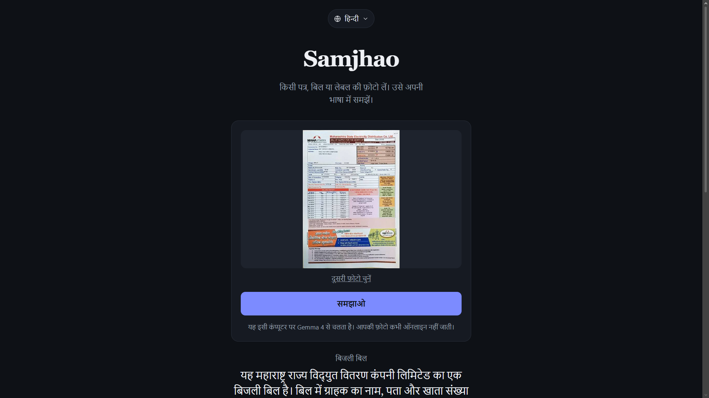
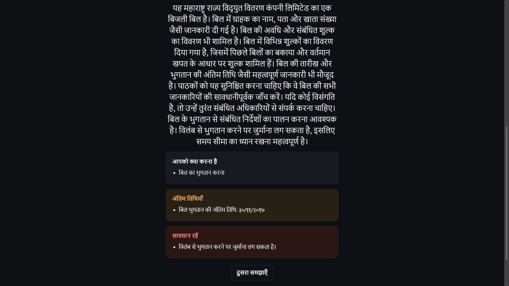

# Samjhao

**Photograph a confusing letter, bill or medicine label and get it explained in your own language. Privately, on your own computer, with no internet.**




## The problem

Millions of people receive official papers they cannot fully read: bank notices, electricity bills, rental clauses, medicine instructions, government letters. They are often written in dense English or legal language. Mistakes can mean missed deadlines, extra fees or health risks.

Online translators and AI chatbots would help, but these documents contain names, addresses, account numbers and health details. Uploading them to a cloud service is a real privacy cost.

## What Samjhao does

1. You upload a photo of a document.
2. You pick a language: Hindi, Bengali, Marathi, Telugu, Tamil, Gujarati, Kannada, Malayalam, Punjabi, Urdu or English.
3. Samjhao shows:

   * what kind of document it is and a short summary in simple words,
   * **what you need to do**,
   * **deadlines** (highlighted),
   * **things to be careful about** (penalties, costs, risks),

Everything runs on your machine. The photo is never sent to the internet.

## How it uses Gemma 4

|Gemma 4 capability|How Samjhao uses it|
|-|-|
|Image input|Reads the document photo directly, with no separate OCR step|
|Multilingual (140+ languages)|Explains the document in the user's language, in that language's own script|
|Structured output|A JSON schema forces a fixed answer shape, so the UI always renders cleanly|
|Open weights (Apache 2.0)|Runs locally through Ollama, so private documents stay private|
|Small effective-parameter sizes|The default `gemma4:e4b` runs on an ordinary laptop|

Thinking mode is turned off (`"think": false`) to keep answers fast on small models.

## Architecture

```
Browser (plain HTML + JS)
        |  POST /explain  (photo + language)
        v
Spring Boot (Java 17)  -- shrinks the photo, builds the prompt and JSON schema
        |  POST /api/chat
        v
Ollama on localhost:11434  -- runs Gemma 4
```

## Requirements

* Java 17 or newer
* Maven (or use your IDE's built-in Maven)
* [Ollama](https://ollama.com) v0.20.0 or newer (check with `ollama --version`)
* About 10 GB of free disk space and 16 GB of RAM for the default model

## Run it

```bash
# 1. Download the model (once)
ollama pull gemma4:e4b

# 2. Start the app
mvn spring-boot:run

# 3. Open the page
# http://localhost:8080
```

The first answer can take up to a minute while the model loads into memory. Later ones are faster.

### Choosing a model

The model name is the `MODEL` constant in `src/main/java/com/example/samjhao/ExplainController.java`.

|Model|Use when|
|-|-|
|`gemma4:e2b`|Your laptop is slow or has little RAM|
|`gemma4:e4b`|Default. Good balance for most laptops|
|`gemma4:26b`|You have a strong GPU or 20+ GB of memory and want better quality|

## Project structure

```
src/main/java/com/example/samjhao/
  SamjhaoApplication.java   Spring Boot entry point
  ExplainController.java       /explain endpoint: image resize, prompt, Ollama call
src/main/resources/
  static/index.html            The whole frontend (no frameworks, no external requests)
  application.properties       Port and upload size limits
```

The page loads no external scripts, fonts or images, so it works fully offline.

## Limitations

* AI can misread blurry or angled photos and can make mistakes. Use clear, well-lit, flat photos.
* Quality varies by language. Hindi is usually strongest, and smaller models are weaker in less common languages.
* Not tested with handwriting or heavily stamped documents.

## Disclaimer

Samjhao gives AI-generated explanations, **not legal, financial or medical advice**. Always check important details with the sender of the document or a qualified professional.

## Privacy

* No accounts, no database, no analytics.
* Uploaded photos are processed in memory and are not saved to disk by this app.

## License

Apache 2.0. Gemma models are released by Google DeepMind under their own terms. See the model card for details.

